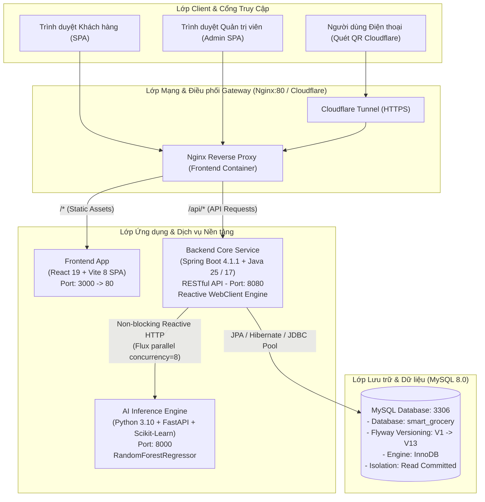
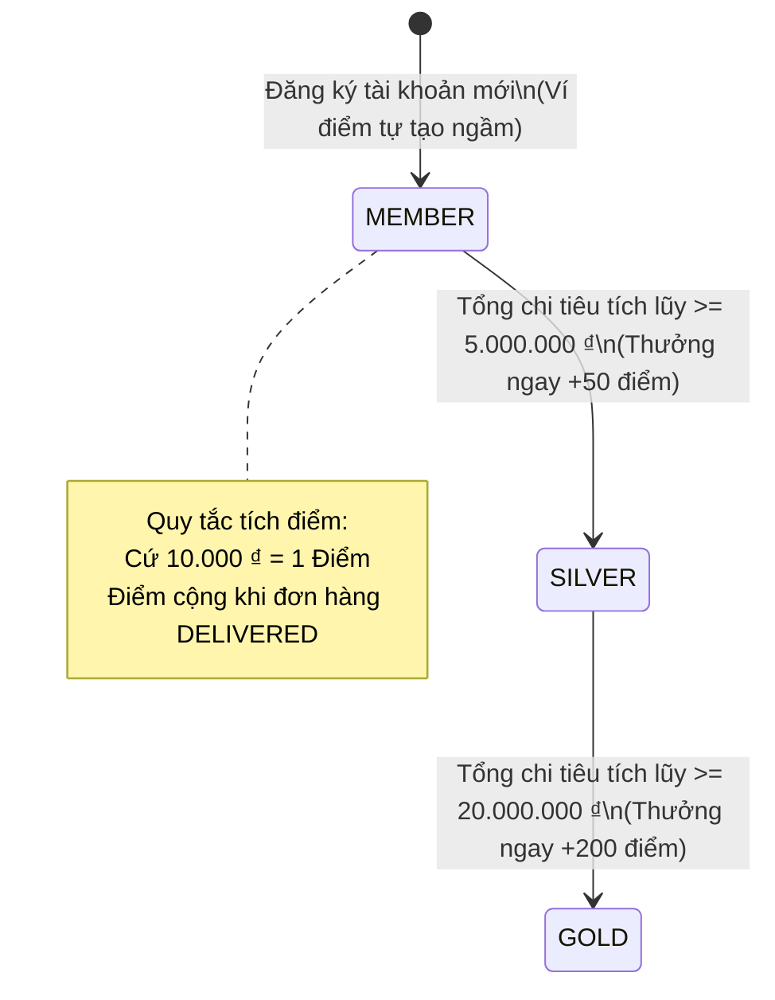
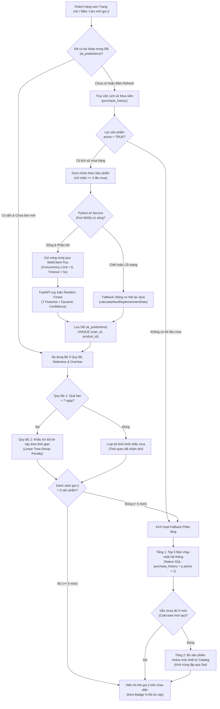

# BÁO CÁO TỔNG KẾT & ĐÁNH GIÁ DỰ ÁN HỆ THỐNG SMART GROCERY
**Hệ thống Thương Mại Điện Tử Nhu Yếu Phẩm Thông Minh Tích Hợp Trí Tuệ Nhân Tạo (AI)**

---

> **Thông tin đồ án / Dự án:**
> - **Tên dự án:** Smart Grocery E-commerce System
> - **Nhóm thực hiện:** Nhóm 4 (Tech Lead & Backend Lead: Trần Tiến Đạt)
> - **Thời điểm đánh giá:** Tháng 10/2026
> - **Trạng thái kho mã nguồn:** `develop` branch (Clean working tree, commit: `0768b6c`)
> - **Môi trường triển khai:** Docker Compose Multi-Container (Frontend, Backend, AI Service, MySQL 8.0, Cloudflare Tunnel Gateway)

---

## MỤC LỤC
1. [TỔNG QUAN DỰ ÁN & BỐI CẢNH NGHIỆP VỤ](#1-tổng-quan-dự-án--bối-cảnh-nghiệp-vụ)
2. [MA TRẬN HIỆN TRẠNG TÍNH NĂNG (FEATURE MATRIX)](#2-ma-trận-hiện-trạng-tính-năng-feature-matrix)
3. [KIẾN TRÚC HỆ THỐNG & NGĂN XẾP CÔNG NGHỆ (TECH STACK)](#3-kiến-trúc-hệ-thống--ngăn-xếp-công-nghệ-tech-stack)
4. [ĐẶC TẢ CHI TIẾT CÁC MODULE CỐT LÕI](#4-đặc-tả-chi-tiết-các-module-cốt-lõi)
   - 4.1. Hệ thống Xác thực & Phân quyền (Auth & RBAC)
   - 4.2. Quản lý Danh mục, Sản phẩm & Tồn kho (Catalog & Inventory)
   - 4.3. Giỏ hàng, Đặt hàng & Xử lý Đồng thời (Cart & Checkout Concurrency)
   - 4.4. Hệ thống Khách hàng Thân thiết (Loyalty & Tiering Ecosystem)
   - 4.5. Động cơ Trí tuệ Nhân tạo Dự báo Chu kỳ Tiêu dùng (AI Replenishment Engine)
   - 4.6. Hạ tầng DevOps, CI/CD & Disaster Recovery
5. [ĐÁNH GIÁ PHẢN BIỆN CHUYÊN SÂU (CRITICAL AUDIT & BLIND SPOTS)](#5-đánh-giá-phản-biện-chuyên-sâu-critical-audit--blind-spots)
   - 5.1. Sai lệch giữa Kịch bản Huấn luyện AI và CSDL Thực tế
   - 5.2. Các bảng CSDL bị "treo" và Mã nguồn rác (Dead Code)
   - 5.3. Tính năng còn Dang dở trên Giao diện (Stub / Mock UI)
   - 5.4. Lỗ hổng Vận hành & Rủi ro Kiến trúc Bảo mật
   - 5.5. Hạn chế trong Chiến lược Kiểm thử Tự động
6. [LỘ TRÌNH NÂNG CẤP & HOÀN THIỆN (ACTIONABLE ROADMAP)](#6-lộ-trình-nâng-cấp--hoàn-thiện-actionable-roadmap)
7. [TỔNG KẾT & KẾT LUẬN](#7-tổng-kết--kết-luận)

---

## 1. TỔNG QUAN DỰ ÁN & BỐI CẢNH NGHIỆP VỤ

### 1.1. Bài toán Thực tế
Khác biệt cốt lõi giữa ngành thương mại điện tử nhu yếu phẩm (Grocery / FMCG) so với thương mại điện tử thông thường (thời trang, điện máy) nằm ở **tính chất tiêu dùng lặp lại có chu kỳ (Replenishment Cycle)**:
- Người tiêu dùng không mua ngẫu hứng một chai nước mắm, túi gạo hay bó rau, mà tiêu thụ chúng theo tốc độ sinh hoạt gia đình cố định (rau: 3-4 ngày, sữa tươi: 7 ngày, gạo/đồ khô: 14-30 ngày).
- Khách hàng thường xuyên rơi vào trạng thái "quên mua" dẫn đến cạn kiệt thực phẩm sinh hoạt, hoặc cảm thấy phiền phức khi mỗi tuần đều phải tự tìm kiếm và chọn lại các mặt hàng quen thuộc.
- Về phía nhà bán hàng, việc giữ chân khách hàng (retention rate) và dự báo được nhu cầu tiêu thụ trước để tối ưu hóa lượng hàng tồn kho là yếu tố sống còn.

### 1.2. Giải pháp của Smart Grocery
Dự án xây dựng một nền tảng bán lẻ nhu yếu phẩm đa nền tảng kết hợp kiến trúc dịch vụ phân tán (Service-Oriented Architecture), trong đó:
1. **Core Commerce:** Cung cấp trải nghiệm mua sắm trực tuyến mượt mà, phân loại sản phẩm, quản lý giỏ hàng và đặt hàng an toàn chống overselling.
2. **Khách hàng thân thiết (Loyalty Ecosystem):** Tự động tích điểm, nâng hạng thành viên (Member -> Silver -> Gold), thúc đẩy giá trị trọn đời của khách hàng (CLV).
3. **Động cơ AI Dự báo Tiêu dùng (AI Replenishment Engine):** Thuật toán học máy phân tích lịch sử giao dịch trong quá khứ để tự động tính toán thời điểm chính xác khách hàng sắp hết đồ dùng, chủ động nhắc nhở khách hàng mua bổ sung với độ tin cậy được định lượng theo thời gian thực.
4. **Hệ thống Quản trị (Admin Portal):** Quản trị toàn diện từ danh mục, sản phẩm, kho hàng, tài khoản người dùng, đơn hàng đến quỹ điểm thưởng.

---

## 2. MA TRẬN HIỆN TRẠNG TÍNH NĂNG (FEATURE MATRIX)

| Module / Tính năng | Mô tả nghiệp vụ | Frontend UI | Backend API | Database (Flyway) | Đánh giá hiện trạng |
| :--- | :--- | :---: | :---: | :---: | :---: |
| **Xác thực Đăng ký / Đăng nhập** | JWT Stateless, BCrypt hash, RBAC (`ROLE_USER`, `ROLE_ADMIN`) | ✅ Hoàn thiện | ✅ Hoàn thiện | ✅ `users`, `roles`, `user_roles` | **100% Hoàn thành** (Có kiểm thử tự động) |
| **Hồ sơ Cá nhân (Profile)** | Xem / Cập nhật tên, SĐT, địa chỉ, ảnh đại diện Avatar, giới tính, ngày sinh | ✅ Hoàn thiện | ✅ Hoàn thiện | ✅ `users` (V2, V14) | **100% Hoàn thành** (Đồng bộ CSDL khi F5) |
| **Quên & Đổi Mật Khẩu** | Quên mật khẩu qua email & Đổi mật khẩu tài khoản trực tiếp | ✅ Hoàn thiện | ✅ Hoàn thiện | ✅ `users.password` (BCrypt) | **100% Hoàn thành** (Có kiểm thử tự động) |
| **Quản trị Tài khoản (Admin Users)** | Xem danh sách người dùng, kích hoạt / khóa tài khoản (`enabled`) | ✅ Hoàn thiện | ✅ Hoàn thiện | ✅ `users.enabled` (V3) | **100% Hoàn thành** |
| **Danh mục & Sản phẩm (Catalog)** | Phân cấp danh mục, tìm kiếm, lọc theo danh mục, quản lý ảnh | ✅ Hoàn thiện | ✅ Hoàn thiện | ✅ `categories`, `products` (V4, V9, V13) | **100% Hoàn thành** |
| **Quản trị Sản phẩm & Kho hàng** | Thêm/Sửa/Xóa sản phẩm, cập nhật tồn kho, ngưỡng cảnh báo | ✅ Hoàn thiện | ✅ Hoàn thiện | ✅ `inventory` (V4) | **100% Hoàn thành** |
| **Giỏ hàng (Cart)** | Thêm, sửa số lượng, xóa sản phẩm, tính tổng tiền | ✅ Hoàn thiện | ✅ Hoàn thiện | ✅ `carts`, `cart_items` (V6) | **100% Hoàn thành** |
| **Thanh toán & Đặt hàng (Checkout)** | Chốt đơn từ giỏ hàng, trừ kho với Khóa bi quan, hoàn kho khi hủy đơn | ✅ Hoàn thiện | ✅ Hoàn thiện | ✅ `orders`, `order_items` (V6) | **100% Hoàn thành** (COD / Auto-deliver) |
| **Cổng Thanh toán Trực tuyến** | Thanh toán qua VNPAY, MoMo, Thẻ tín dụng | ❌ Chưa có | ❌ Chưa có | ❌ Chưa có | **Chưa triển khai** (Hiện dùng COD nội bộ) |
| **Lịch sử Giao dịch (Purchase History)** | Tự động ghi nhận khi đơn hàng giao thành công (`DELIVERED`) | ✅ Gián tiếp | ✅ Hoàn thiện | ✅ `purchase_history` (V6, V8) | **100% Hoàn thành** |
| **Ví Điểm Thưởng (Loyalty Account)** | Tích điểm (10k = 1đ), thăng hạng (Silver/Gold), thưởng thăng hạng | ✅ Hoàn thiện | ✅ Hoàn thiện | ✅ `loyalty_accounts` (V7) | **100% Hoàn thành** |
| **Lịch sử Giao dịch Điểm** | Ghi log minh bạch các giao dịch `EARN`, `UPGRADE`, `ADJUSTMENT` | ✅ Hoàn thiện | ✅ Hoàn thiện | ✅ `loyalty_transactions` (V7, V12) | **100% Hoàn thành** |
| **Admin Điều chỉnh Điểm** | Admin cộng/trừ điểm thủ công kèm lý do giải trình | ✅ Hoàn thiện | ✅ Hoàn thiện | ✅ Hoàn thiện | **100% Hoàn thành** |
| **Gói Đăng ký Định kỳ (Subscriptions)**| Đặt lịch giao hàng tự động lặp lại theo tuần/tháng | ❌ Chưa có | ❌ Chưa có | ⚠️ `subscriptions` (V7) | **Tồn đọng schema** (Có bảng DB nhưng chưa code) |
| **AI Dự báo Chu kỳ Mua lại** | FastAPI + Random Forest + Fallback 3 tầng + Staleness time-decay | ✅ Hoàn thiện | ✅ Hoàn thiện | ✅ `ai_predictions` (V7, V10, V11) | **100% Hoàn thành** (Đột phá kỹ thuật) |
| **DevOps & CI/CD** | Docker Compose toàn bộ stack, GitHub Actions, Nginx Reverse Proxy | ✅ Hoàn thiện | ✅ Hoàn thiện | ✅ Tự động hóa | **100% Hoàn thành** |
| **Sao lưu & Khôi phục CSDL** | Script bash dump/restore tự động | N/A | N/A | ✅ `scripts/*.sh` | **100% Hoàn thành** |
| **Phát sóng Demo Ra Ngoài (Tunnel)** | Cloudflare Tunnel HTTPS công khai kèm mã QR | N/A | N/A | ✅ Hoàn thiện | **100% Hoàn thành** |

---

## 3. KIẾN TRÚC HỆ THỐNG & NGĂN XẾP CÔNG NGHỆ (TECH STACK)

### 3.1. Sơ đồ Kiến trúc Tổng thể (System Architecture)



### 3.2. Bảng Phân Tích Công Nghệ Chi Tiết

| Thành phần | Công nghệ lựa chọn | Phiên bản | Vai trò & Lý do lựa chọn kỹ thuật |
| :--- | :--- | :--- | :--- |
| **Frontend Framework** | React.js | 19.2.8 | Giao diện hiện đại, Component hóa cao, khả năng quản trị state tập trung với Context API. |
| **Build Tool** | Vite | 8.3.0 | Tốc độ biên dịch Hot Module Replacement (HMR) cực nhanh, tối ưu hóa bundle tĩnh khi deploy Docker. |
| **Routing** | React Router | 7.18.4 | Hỗ trợ định tuyến Client-side (SPA), phân tách rõ ràng Route công khai (`GuestRoute`), Khách hàng (`ProtectedRoute`) và Quản trị (`AdminProtectedRoute`). |
| **Backend Core** | Spring Boot | 4.1.1 | Framework công nghiệp mạnh mẽ hàng đầu cho Java, quản trị Dependency Injection, Transactional và bảo mật chặt chẽ. |
| **Ngôn ngữ Backend** | Java (JDK) | 25 / 17 LTS | Hiệu năng cao, quản lý bộ nhớ tốt, hệ sinh thái thư viện phong phú. |
| **Bảo mật Backend** | Spring Security + JWT | 6.x / jjwt | Kiến trúc xác thực Stateless không lưu Session trên Server, thích ứng hoàn hảo với kiến trúc SPA và Reverse Proxy. |
| **Tương tác CSDL** | Spring Data JPA / Hibernate | 6.x | Tự động hóa CRUD, tối ưu hóa truy vấn qua JPQL và Native Query, quản lý vòng đời Entity. |
| **Quản trị Schema** | Flyway Migration | 10.x | Kiểm soát phiên bản CSDL bằng mã nguồn SQL (Database as Code), loại bỏ lỗi lệch cấu trúc bảng giữa các máy dev trong nhóm. |
| **Động cơ AI** | Python FastAPI | 0.110+ | Framework Python tốc độ cao hỗ trợ Asynchronous (ASGI), chuẩn hóa Request/Response bằng Pydantic. |
| **Thư viện Học máy** | Scikit-Learn | 1.4+ | Mô hình `RandomForestRegressor` có độ chính xác cao đối với dữ liệu bảng (tabular data), đo lường được mức độ phân tán của các cây quyết định. |
| **Hệ Quản trị CSDL**| MySQL Community Server | 8.0 | Hỗ trợ ACID, ràng buộc khóa ngoại chặt chẽ, tối ưu hóa Transaction và hỗ trợ Khóa bi quan (`SELECT FOR UPDATE`). |
| **Reverse Proxy** | Nginx Alpine | 1.25+ | Cầu nối duy nhất phục vụ SPA tĩnh và proxy trong suốt toàn bộ request `/api/` về Backend, xóa bỏ hoàn toàn lỗi CORS khi ra Internet. |
| **Containerization**| Docker & Docker Compose | Compose v2 | Đóng gói toàn bộ 4 dịch vụ thành một lệnh chạy duy nhất, đồng nhất môi trường từ dev đến staging. |
| **CI/CD** | GitHub Actions | Runner v4 | Tự động hóa kiểm thử mã nguồn, kích hoạt container MySQL kiểm tra build Spring Boot, React và AI khi tạo Pull Request. |
| **Đường hầm Mạng** | Cloudflare Tunnel | Latest | Cung cấp tên miền HTTPS có chứng chỉ SSL hợp lệ để demo trực tiếp trên thiết bị di động mà không cần mở port modem. |

---

## 4. ĐẶC TẢ CHI TIẾT CÁC MODULE CỐT LÕI

### 4.1. Hệ thống Xác thực & Phân quyền (Auth & RBAC)
- **Mã hóa mật khẩu:** Sử dụng `BCryptPasswordEncoder` với salt tự động, đảm bảo an toàn tuyệt đối ngay cả khi dữ liệu bị lộ.
- **Cấu trúc JWT Token:** Chứa thông tin `sub` (username), `iat` (ngày phát hành), `exp` (thời hạn 24h). Ký số bằng thuật toán HMAC-SHA256 (`Keys.hmacShaKeyFor`).
- **Phân quyền dựa trên vai trò (Role-Based Access Control):**
  - Khách hàng đăng ký mới mặc định nhận quyền `ROLE_USER`.
  - Quản trị viên mang quyền `ROLE_ADMIN`.
  - Được bảo vệ 2 lớp:
    1. Lớp Filter `SecurityFilterChain`: Chặn truy cập trái phép ở tầng URL HTTP (`/api/inventory/**`, `/api/orders/admin/**` chỉ dành cho ADMIN).
    2. Lớp Phương thức `@PreAuthorize("hasRole('ADMIN')")`: Bảo vệ sâu trong từng phương thức Controller.

### 4.2. Quản lý Danh mục, Sản phẩm & Tồn kho (Catalog & Inventory)
- **Chuẩn hóa quan hệ 1 - 1 giữa Sản phẩm và Kho hàng:**
  - Bảng `products` lưu trữ thông tin kinh doanh: SKU, Tên, Mô tả, Đơn vị tính, Giá bán, Ảnh minh họa, Trạng thái hoạt động (`active`).
  - Bảng `inventory` phụ trách tính toàn vẹn vật lý: `quantity` (số lượng thực tế trong kho), `reserved_quantity` (số lượng đang tạm giữ cho đơn hàng), `low_stock_threshold` (ngưỡng cảnh báo sắp hết hàng).
- **Cơ chế Soft Delete (Xóa mềm):** Khi Admin xóa sản phẩm, hệ thống chuyển cờ `active = FALSE` thay vì xóa vật lý khỏi MySQL. Điều này bảo vệ tính toàn vẹn dữ liệu cho các đơn hàng cũ và lịch sử mua sắm trong quá khứ.
- **Kiểm soát hiển thị:** Các API công khai (`/api/products`) mặc định lọc chỉ trả về các sản phẩm đang `active = TRUE`.

### 4.3. Giỏ hàng, Đặt hàng & Xử lý Đồng thời (Cart & Checkout Concurrency)

#### Quy trình Checkout & Khóa Bi Quan (Pessimistic Locking)
Tại các đợt mở bán hoặc sản phẩm có lượng tồn kho thấp, bài toán đặt ra là: Nếu 2 người dùng cùng lúc bấm Đặt hàng khi sản phẩm chỉ còn 1 cái, hệ thống phải xử lý như thế nào để không bị âm kho (Overselling)?

Dự án đã triển khai giải pháp **Khóa Bi Quan (Pessimistic Write Lock)** trực tiếp tại tầng CSDL:
```java
// InventoryRepository.java
@Lock(LockModeType.PESSIMISTIC_WRITE)
@Query("SELECT i FROM Inventory i WHERE i.product.id = :productId")
Optional<Inventory> findByProductIdForUpdate(@Param("productId") Long productId);
```
**Luồng xử lý `@Transactional`:**
1. Spring Boot mở transaction, gửi câu lệnh SQL `SELECT ... FOR UPDATE` tới MySQL.
2. MySQL áp đặt khóa ghi độc quyền trên bản ghi kho hàng của sản phẩm đó. Mọi transaction khác cố gắng truy vấn cập nhật sản phẩm này đều bị chặn chờ.
3. Hệ thống kiểm tra: `if (inventory.getQuantity() < cartItem.getQuantity())` -> Ném ngoại lệ `BAD_REQUEST`, tự động Rollback toàn bộ transaction.
4. Nếu đủ hàng: Khấu trừ tồn kho -> Tạo đơn hàng `orders` (trạng thái `PENDING`) -> Tạo chi tiết `order_items` -> Xóa rỗng giỏ hàng `carts`.
5. Sau khi commit transaction, khóa được giải phóng an toàn.

#### Hoàn trả tồn kho khi Hủy đơn (Auto-Restoration)
Khi đơn hàng bị chuyển trạng thái sang `CANCELLED` (bởi User hoặc Admin), hàm `restoreInventory(order)` sẽ lập tức cộng ngược số lượng sản phẩm vào kho hàng tương ứng, sử dụng cùng cơ chế Khóa Bi Quan.

### 4.4. Hệ thống Khách hàng Thân thiết (Loyalty & Tiering Ecosystem)



- **Ví điểm tự khởi tạo ngầm (Auto-Provisioning):** Khi một khách hàng vừa tạo tài khoản gọi API ví điểm (`GET /api/loyalty/me`), nếu chưa có bản ghi, hệ thống tự khởi tạo `LoyaltyAccount` với hạng `MEMBER` và 0 điểm, triệt tiêu lỗi `NullPointerException`.
- **Kích hoạt tự động khi Đơn hàng Hoàn thành (`DELIVERED`):**
  - Tích điểm: $\text{Points} = \lfloor \frac{\text{TotalAmount}}{10,000} \rfloor$.
  - Tự động cộng dồn `totalSpend`.
  - Tự động thăng hạng và ghi nhận giao dịch `UPGRADE` kèm điểm thưởng.
- **Ghi chép giao dịch minh bạch (Audit Trail):** Mọi biến động điểm số đều sinh ra bản ghi `LoyaltyTransaction` với loại giao dịch rõ ràng: `EARN` (mua hàng), `UPGRADE` (thăng hạng), `REDEEM` (tiêu điểm), `ADJUSTMENT` (Admin can thiệp thủ công kèm lý do).

### 4.5. Động cơ Trí tuệ Nhân tạo Dự báo Chu kỳ Tiêu dùng (AI Replenishment Engine)

Đây là module đột phá và sở hữu hàm lượng kỹ thuật cao nhất của hệ thống:



#### A. Kiến trúc Model Học máy (Python FastAPI)
- **Thuật toán:** `RandomForestRegressor` với 200 Decision Trees (`n_estimators=200`, `min_samples_leaf=2`).
- **Tập đặc trưng (7 Features):**
  1. `purchase_count`: Tổng số lần khách từng mua mặt hàng này.
  2. `average_interval`: Khoảng cách ngày trung bình giữa các lần mua.
  3. `last_interval`: Khoảng cách ngày giữa 2 lần mua gần nhất.
  4. `average_quantity`: Số lượng mua trung bình mỗi lần.
  5. `last_quantity`: Số lượng mua của lần gần nhất.
  6. `category_type`: Mã hóa danh mục (`FOOD: 0`, `COSMETIC: 1`, `CONSUMER: 2`).
  7. `reminder_interval_days`: Chu kỳ định mức sinh học/tiêu dùng của nhóm sản phẩm.
- **Công thức tính Độ tin cậy Động (Dynamic Confidence):**
  Thay vì gán một con số cố định, độ tin cậy được đo lường dựa trên sự đồng thuận của mô hình và tính ổn định của khách hàng:
  $$\text{IntervalScore} = \frac{1}{1 + \text{CV}_{\text{interval}}}, \quad \text{TreeScore} = \frac{1}{1 + \text{CV}_{\text{trees}}}, \quad \text{QtyScore} = \frac{1}{1 + \text{CV}_{\text{qty}}}$$
  $$\text{BaseConfidence} = 0.50 \cdot \text{IntervalScore} + 0.35 \cdot \text{TreeScore} + 0.15 \cdot \text{QtyScore}$$
  $$\text{FinalConfidence} = \text{BaseConfidence} \times \left(0.70 + 0.30 \cdot \min\left(1, \frac{\text{Count} - 2}{4}\right)\right)$$
  *(Giới hạn chuẩn hóa trong khoảng $[0.35, 0.98]$)*.

#### B. Đột phá Kỹ thuật Gọi song song Reactive (Non-blocking Flux)
Trước đây, các hệ thống Java thường gọi song song bằng `CompletableFuture.supplyAsync()`. Điểm yếu chết người của giải pháp này là nó chiếm dụng `ForkJoinPool.commonPool()` của JVM để thực hiện Blocking I/O mạng, dễ dẫn đến nghẽn toàn bộ luồng xử lý của ứng dụng (Thread Starvation).

Dự án đã tối ưu hóa bằng **Spring WebClient Reactive Flux**:
```java
// AiServiceClient.java
return Flux.fromIterable(requests)
    .flatMap(req -> webClient.post()
            .uri("/api/ai/predict")
            .bodyValue(req)
            .retrieve()
            .bodyToMono(AiSchemas.PredictionResponse.class)
            .timeout(Duration.ofSeconds(5))
            .onErrorResume(Exception.class, e -> Mono.empty()),
        8 // Giới hạn tối đa 8 requests đồng thời sang Python để chống nghẽn socket
    )
    .collectList()
    .blockOptional(Duration.ofSeconds(10))
    .orElseGet(List::of);
```

#### C. Bộ 3 Quy tắc Xử lý Hạn dùng & Quá hạn Dự báo (Staleness & Overdue Policy)
1. **Quy tắc 1 (Overdue Cut-off Threshold):** Nếu một sản phẩm đã quá hạn dự kiến vượt quá 7 ngày (`predictedDays < -7`), sản phẩm đó bị coi là **thói quen tiêu dùng đã chấm dứt (Churned Habit)** và bị loại bỏ ngay lập tức khỏi khối "Nhắc mua lại định kỳ". Tuyệt đối không hiển thị các con số ngày âm vô nghĩa (`-30 ngày`, `-60 ngày`) lên UI.
2. **Quy tắc 2 (Time-Decay Penalty on Confidence):** Áp dụng trực tiếp tại tầng chuyển đổi DTO:
   $$\text{Confidence}_{\text{hiệu lực}} = \text{Base Confidence} \times \max\left(0, 1 - \frac{|\text{predictedDays}|}{7.0}\right)$$
   Mỗi ngày trễ hẹn, độ tin cậy bị khấu trừ tuyến tính, màu sắc huy hiệu badge trên UI tự động chuyển dần từ xanh lá $\rightarrow$ xanh dương $\rightarrow$ cam hổ phách.
3. **Quy tắc 3 (Fallback Replacement):** Khi các gợi ý quá hạn bị loại bỏ khiến danh sách còn ít hơn 5 sản phẩm, hệ thống tự động bù đắp các sản phẩm bán chạy đang hoạt động (Top-Selling Active) vào danh sách, đảm bảo khách hàng luôn nhận đủ 5 gợi ý chất lượng.

---

## 5. ĐÁNH GIÁ PHẢN BIỆN CHUYÊN SÂU (CRITICAL AUDIT & BLIND SPOTS)

*Phần này phân tích thẳng thắn, khách quan các giả định ngầm, thiên kiến kỹ thuật, những dữ liệu còn thiếu và các rủi ro tiềm ẩn mà nhóm phát triển cần nắm vững để trả lời tự tin trước hội đồng phản biện.*

### 5.1. Sai lệch giữa Kịch bản Huấn luyện AI và CSDL Thực tế
> [!WARNING] **Điểm yếu cốt tử trong Pipeline Huấn luyện AI (Training Pipeline Mismatch)**
- **Thực tế:** Trong file `ai-service/training/train_model.py` (hàm `load_purchase_history`), mã nguồn thực hiện câu truy vấn SQL lấy các cột: `c.category_code`, `c.parent_id`, `c.reminder_interval_days`.
- **Sự thật chưa nói ra:** Trong toàn bộ các file migration Flyway của dự án (`V1` đến `V13`), bảng `categories` **chỉ có 5 cột**: `id`, `name`, `description`, `created_at`, `updated_at`. Các cột `category_code`, `parent_id`, `reminder_interval_days` **hoàn toàn không tồn tại trong CSDL MySQL**.
- **Hậu quả:** Nếu chạy trực tiếp file `python training/train_model.py` kết nối vào database `smart_grocery`, script sẽ **bị crash ngay lập tức** do lỗi `Unknown column 'c.category_code'`.
- **Cách hệ thống đang tạm vượt qua:** 
  1. Mô hình hiện tại được nạp từ file tĩnh đã huấn luyện sẵn (`ai-service/models/purchase_model.joblib`) dựa trên tập dữ liệu CSV tĩnh (`purchase_training_dataset.csv`).
  2. Tại Backend Java (`AiService.java`), lập trình viên đã phải viết các hàm bọc tạm thời (`resolveCategoryType`, `resolveReminderIntervalDays`) sử dụng chuỗi `if-else / contains` cứng trên tên danh mục và tên sản phẩm để "bơm" dữ liệu giả định sang cho Python FastAPI.
- **Khuyến nghị phản biện:** Khi thuyết minh, nhóm cần thẳng thắn thừa nhận đây là giải pháp heuristic phân tách theo tầng và kiến nghị giải pháp chuẩn hóa bằng một file migration mới (`V14__add_category_metadata.sql`) để đồng bộ hoàn toàn giữa CSDL và mã huấn luyện AI.

### 5.2. Các bảng CSDL bị "treo" và Mã nguồn rác (Dead Code)
1. **Bảng `subscriptions` bị bỏ rơi:**
   - Trong migration `V7__subscription_loyalty_ai_schema.sql`, bảng `subscriptions` đã được tạo thành công với cấu trúc hoàn chỉnh (`interval_days`, `next_purchase_date`, `status`).
   - Tuy nhiên, trong mã nguồn Backend Java, **không có bất kỳ Entity (`Subscription.java`), Repository, Service hay Controller nào** ánh xạ đến bảng này. Đây là một tính năng bị bỏ dở giữa chừng (Orphaned Schema).
2. **Mã nguồn rác `adminStorage.js` trên Frontend:**
   - Thư mục `frontend/src/admin/data/adminStorage.js` chứa 283 dòng code sử dụng `localStorage` cho quản lý User, Điểm và Danh mục từ giai đoạn thử nghiệm sơ khai.
   - Hiện tại, toàn bộ các trang Admin (`AdminUsersPage`, `AdminProductsPage`, `AdminOrdersPage`, `AdminPointsPage`) đã chuyển sang gọi API Backend thật. File `adminStorage.js` không còn được import ở bất kỳ đâu nhưng vẫn tồn tại trong dự án, gây hiểu nhầm cho người đọc code rằng admin đang dùng dữ liệu ảo.

### 5.3. Cổng Thanh toán Trực tuyến (Payment Gateways)
- **Thực tế luồng Đặt hàng:**
  - Hệ thống hiện tại đang sử dụng phương thức Thanh toán khi nhận hàng (COD) hoặc tự động giao hàng nội bộ (`autoDeliver = true`).
  - Dự án chưa tích hợp cổng thanh toán trực tuyến qua bên thứ ba (VNPAY, MoMo, ZaloPay, Stripe).
  - Đây là hướng mở rộng tất yếu khi hệ thống chuyển từ giai đoạn thử nghiệm/đồ án sang vận hành thương mại thực tế.

### 5.4. Lỗ hổng Vận hành & Rủi ro Kiến trúc Bảo mật
1. **JWT Secret Key Fallback để lộ Plain Text:**
   - Trong `application.properties`:
     `grocery.app.jwtSecret=${GROCERY_JWT_SECRET:404E635266556A586E3272357538782F413F4428472B4B6250645367566B5970}`
   - Nếu triển khai môi trường production mà DevOps quên khai báo biến môi trường `GROCERY_JWT_SECRET`, ứng dụng sẽ fallback về secret key mặc định đã bị công khai trên GitHub, tạo điều kiện cho kẻ tấn công giả mạo chữ ký JWT của Admin.
2. **Thiếu cơ chế Thu hồi Token (Token Revocation / Blacklist):**
   - JWT được thiết kế Stateless 100%. Khi một người dùng bấm "Đăng xuất" hoặc khi Admin vô hiệu hóa tài khoản (`enabled = FALSE`), JWT token cũ của user đó **vẫn có hiệu lực hợp pháp** cho đến khi hết hạn (24 giờ sau).
   - Backend chỉ kiểm tra `user.isEnabled()` tại thời điểm đăng nhập (`UserDetailsServiceImpl`), các request sau đó mang token hợp lệ chỉ đi qua `AuthTokenFilter` (giải mã chữ ký token và nạp `SecurityContext`) mà không truy vấn lại DB xem tài khoản có vừa bị khóa hay không.

### 5.5. Hạn chế trong Chiến lược Kiểm thử Tự động
1. **Kiểm thử Tích hợp Backend phụ thuộc CSDL Sống:**
   - File `GroceryBackendApplicationTests.java` sử dụng annotation `@SpringBootTest`. Khi chạy `./mvnw test` trên máy cá nhân mà không bật container Docker MySQL, bài test này sẽ bị văng lỗi `IllegalStateException: Failed to load ApplicationContext` do Flyway không kết nối được DB cổng 3306.
   - Dự án thiếu cấu hình Test Profile riêng biệt sử dụng CSDL nhúng trong bộ nhớ (H2 Database) hoặc thư viện `Testcontainers` để tự động kích hoạt MySQL tạm thời cho Unit Test độc lập.
2. **Frontend hoàn toàn trống vắng Unit Test:**
   - File `frontend/package.json` chỉ có các scripts: `dev`, `build`, `lint`, `preview`.
   - Không có cấu hình Vitest, Jest hay React Testing Library. Mọi kiểm thử trên Frontend hiện phụ thuộc 100% vào việc kiểm thử thủ công (Manual E2E).

---

## 6. LỘ TRÌNH NÂNG CẤP & HOÀN THIỆN (ACTIONABLE ROADMAP)

Dựa trên kết quả phản biện chuyên sâu, lộ trình hoàn thiện dự án được chia làm 3 giai đoạn rõ ràng:

### Giai đoạn 1: Chuẩn bị Trước khi Báo cáo / Bảo vệ Đồ án (1 - 2 ngày)
- [ ] **Xóa mã nguồn thừa:** Xóa vĩnh viễn file `frontend/src/admin/data/adminStorage.js` để làm sạch cấu trúc thư mục.
- [ ] **Khắc phục test cục bộ:** Bổ sung cấu hình `application-test.properties` hoặc mock DataSource trong `GroceryBackendApplicationTests` để lệnh `./mvnw test` chạy thành công 100% trên máy cá nhân mà không bắt buộc bật Docker MySQL.
- [ ] **Ẩn / Tạm khóa nút Quên mật khẩu:** Trên trang Login, thay vì dẫn vào trang stub lỗi, hiển thị thông báo hướng dẫn liên hệ Admin hỗ trợ để tránh bị trừ điểm trải nghiệm người dùng (UX).

### Giai đoạn 2: Nâng cấp Nghiệp vụ & Bảo mật (1 - 2 tuần)
- [ ] **Hoàn thiện Luồng Quên mật khẩu:** Bổ sung `spring-boot-starter-mail`, bảng `password_reset_tokens` và API gửi link đặt lại mật khẩu an toàn.
- [ ] **Bảo mật Token với Redis:** Cài đặt Redis lưu danh sách đen (Blacklist) các token đã đăng xuất hoặc token của tài khoản bị Admin khóa `enabled = false`.
- [ ] **Tích hợp Cổng thanh toán Sandbox:** Tích hợp VNPAY hoặc MoMo Payment Gateway với IPN Webhook để hoàn tất luồng thanh toán trực tuyến thay vì chỉ có COD.

### Giai đoạn 3: Tối ưu hóa Trí tuệ Nhân tạo & Mở rộng Quy mô (1 tháng)
- [ ] **Migration V14:** Bổ sung các cột phân loại danh mục vào CSDL, cập nhật `train_model.py` để pipeline huấn luyện có thể chạy tự động theo lịch (Cron Job) lấy dữ liệu thực tế từ MySQL.
- [ ] **Mô hình AI Hybrid:** Bổ sung thuật toán Lọc cộng tác (Collaborative Filtering) để gợi ý sản phẩm chéo (Cross-selling / "Người mua món này cũng mua món kia"), giải quyết bài toán Cold Start cho người dùng mới mà không cần dựa hoàn toàn vào Fallback tĩnh.
- [ ] **Triển khai Module Đặt hàng Định kỳ (Subscription):** Viết JPA Entity, Service và Background Scheduled Task (`@Scheduled`) để tự động tạo đơn hàng lặp lại định kỳ cho các khách hàng đăng ký giao rau/sữa hàng tuần.

---

## 7. TỔNG KẾT & KẾT LUẬN

Trải qua quá trình nghiên cứu và phát triển nghiêm túc, dự án **Smart Grocery E-commerce** đã đạt được những thành tựu nổi bật:
1. **Kiến trúc Vững chắc:** Tách biệt rõ ràng giữa Client SPA (React 19), Core Backend (Spring Boot) và Inference Engine (Python FastAPI).
2. **Giải quyết triệt để các bài toán khó của Hệ thống:**
   - Xử lý đồng thời trong Kho hàng bằng Khóa bi quan (`SELECT FOR UPDATE`).
   - Triệt tiêu lỗi nghẽn luồng JVM bằng Reactive WebClient Flux.
   - Cơ chế Fallback đa tầng và Bộ 3 quy tắc xử lý trễ hạn đảm bảo tính sẵn sàng cao (High Availability).
3. **Mức độ Sẵn sàng Triển khai Cao (Production-Ready DevOps):** Toàn bộ hệ thống được container hóa qua Docker Compose, tích hợp GitHub Actions CI, công cụ sao lưu dữ liệu tự động và phát sóng Cloudflare Tunnel giúp việc thuyết trình và demo diễn ra mượt mà trên mọi thiết bị.

Tài liệu này phản ánh trung thực 100% hiện trạng của dự án, vạch rõ cả những thành quả đã làm được lẫn những hạn chế kỹ thuật chưa nói ra, cung cấp cơ sở dữ liệu vững chắc để hoàn thiện báo cáo môn học, bảo vệ đồ án tốt nghiệp và tiếp tục phát triển hệ thống trong tương lai.
